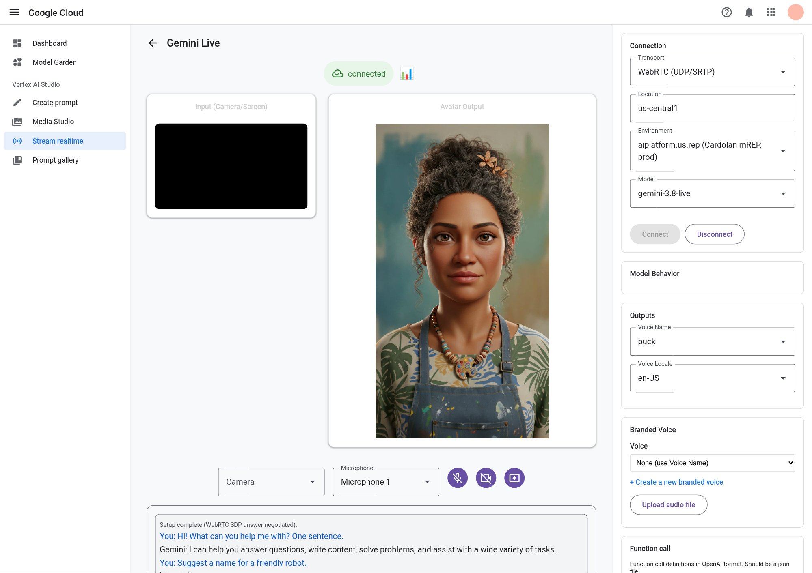

# Gemini Live API Demo

A web app for talking to Gemini through the [Gemini Live API](https://cloud.google.com/vertex-ai/generative-ai/docs/model-reference/multimodal-live) with your voice, camera, or screen. The model can answer with audio, text, or a talking avatar video.

<details>
<summary>Screenshot</summary>



</details>

## Architecture

- **Frontend** (`frontend/`): plain HTML and JavaScript with Material Web components. It captures the microphone, camera, or screen, plays the model's audio and video, and shows the conversation.
- **Backend** (`backend/`): an aiohttp server that serves the frontend and proxies each session's WebSocket to the Live API, adding the OAuth token. The browser never sees the token.

Two transports are available:

- **WebSocket**: audio, camera frames (JPEG), and the model's audio and MP4 video all travel as JSON over the WebSocket.
- **WebRTC**: the WebSocket only carries setup and control messages; media flows over a WebRTC peer connection, which gives lower latency. Not every endpoint supports it.

Both transports are tested in Chrome and Firefox. Safari support is intended but untested.

## Coding agent skill

`.agents/skills/gemini-live-webrtc/` is an agent skill for adding Live API WebRTC to your own app: the integration steps, common mistakes, troubleshooting, and small voice and avatar examples. Coding agents that read `SKILL.md` skills, such as Antigravity, pick it up when you open this repository. To use it in another project, copy the folder into that project's `.agents/skills/`.

## Run locally

Requires Python 3.11 or later.

1. Install dependencies:

    ```sh
    python3 -m venv .venv
    source .venv/bin/activate
    pip install -r backend/requirements.txt
    ```

1. Set up Application Default Credentials for an account with access to Vertex AI:

    ```sh
    gcloud auth application-default login
    ```

1. Start the server:

    ```sh
    python backend/main.py --project_id=YOUR_PROJECT_ID
    ```

1. Open http://localhost:8080 and click **Connect**.

### Server options

| Option | Default | Purpose |
| --- | --- | --- |
| `--project_id` | `$GOOGLE_CLOUD_PROJECT`, then `live-api-webrtc-testing` | Project used for Live API sessions and the function-call simulator. |
| `--allowed_host_suffixes` | `.googleapis.com` | Upstream hosts the proxy may connect to. The proxy sends its access token to these hosts, so keep the list tight. |
| `--allowed_hosts` | none | Extra host names browsers may use to reach the server, such as a custom domain or the public host of a proxy that rewrites `Host`. localhost, IP addresses, this machine's names, and `*.run.app` on Cloud Run are always allowed. Entries are host names with an optional port (`demo.example.com:8443`); the server refuses to start on anything else, such as a URL. |
| `--fr_simulator_model` | `gemini-3-flash-preview` | Model that simulates function responses. |
| `--fr_simulator_thinking_level` | `low` | Its thinking level; empty uses the model's default. |
| `--ws_heartbeat_s` | `20` | Seconds between WebSocket pings to the browser and to the Live API. Keeps quiet sessions (mic muted, text only) from being closed by proxies that drop idle connections, and ends a session whose browser or upstream has silently gone away. `0` disables pings. |
| `--max_sessions` | `0` (no limit) | Most sessions held at once, counting ones still connecting. Further connects get HTTP 503 (the browser retries for a few seconds, then shows the error). A session's slot frees when its browser disconnects, so a resume isn't refused while the old upstream connection finishes closing (at most 10 s), or when the browser gives up before connecting (e.g. Disconnect while connecting); a session that never connects otherwise expires after 60 s. Set it on public deployments to bound the upstream connections one instance can be made to open. |
| `--idle_timeout_s` | `900` | The browser ends a session after this many seconds without conversation or user input (typing, clicks, speech the model answers), so an abandoned tab doesn't keep its upstream connection and `--max_sessions` slot. The frontend enforces it, since the proxy can't tell an idle session from an active one: WebRTC media bypasses it, and avatar video and an open microphone stream while nobody is there. `0` disables it. |
| `--debug` | off | Debug logging, including a preview of every proxied message. |
| `PORT` (env) | `8080` | Port to listen on. |

The API and WebSocket only accept browser requests from the app's own pages, under an allowed host name, so other websites (including through DNS rebinding) can't use the server's credentials. Clients that send no `Origin` header, such as `scripts/smoke_test.py`, are allowed.

The page is served with a Content-Security-Policy (`CONTENT_SECURITY_POLICY` in `backend/main.py`) that runs scripts only from the app and the Material Web CDN, connects only to the app's own server, and stops other sites from framing it. Keep `frontend/index.html` free of inline `<script>` blocks and `on*` attributes: attach handlers in `initDOMEventListeners()` in `frontend/script.js`. A new script or font host has to be added to the policy; `test_index_html_has_nothing_the_csp_blocks` and the browser e2e catch what it blocks.

### Credentials

The backend tries, in order: Application Default Credentials through google-auth, then `gcloud auth application-default print-access-token`, then the LOAS helper `backend/common_bag_ws_proxy.par` if present. The gcloud fallback matters on machines with certificate-based access, where google-auth's own token refresh fails with "Account restricted" but gcloud works. The server log says which source it used.

## Using the app

- **Connection**: pick the transport, location, environment (endpoint), and model, then **Connect**. Changing the environment adjusts the model to one it serves.
- **Text**: type in the message box and press Enter.
- **Voice**: click the microphone button to start or stop sending audio. Turn on input and output transcripts in **Advanced Settings** to see what was heard and said.
- **Camera and screen**: the camera button sends your camera; the screen button shares a screen or window. Only one runs at a time. If the microphone or camera stops on its own (unplugged, or the browser's access to it turned off), the app turns its button off and says so.
- **Response type** (in **Model Behavior**): Video (avatar), Audio, or Text.
- **Branded voice**: upload an audio file (any format the browser can decode; it is converted to 24 kHz mono WAV) or record one with **Create a new branded voice**, then pick it in the **Voice** dropdown, or pick **None** to use the prebuilt voice. The sample is sent in the session's setup message, so changes apply to the next connection. The project must be allowlisted for replicated voice; otherwise the session closes with "not allowlisted for replicated voice".
- **Function calling**: upload a JSON list of function declarations before connecting; `fc_definition.json` is an example. When the model calls a function, the backend asks `gemini-3-flash-preview` (with low thinking, about a second) to simulate a plausible response and sends it back to the model. Change the model with `--fr_simulator_model` and `--fr_simulator_thinking_level`.
- **Session resumption**: on by default. When the Live API announces it will close the connection (GoAway), or the backend restarts (e.g. a deploy), the app reconnects with the session's latest resumption handle and the conversation continues. Automatic reconnects are limited to three a minute, so a server that keeps closing connections ends the session with an error instead of a reconnect loop. Disconnect ends the conversation; the chat log shows its handle, which you can enter under **Advanced Settings** before connecting to resume it.
- **Custom avatar**: under **Avatar**, upload an image (or use the bundled sample) to replace the stock "Piper" avatar from the next connection. The project must be allowlisted for custom avatars; otherwise the session closes with "not allowlisted for customized avatar".
- **Saving the avatar video**: with **Save avatar video** checked, the avatar's MP4 stream (WebSocket transport) is downloaded when you disconnect.
- **Metrics**: hover over 📊 to see transport, bandwidth, frame rate, packet loss, token usage for the last turn, and response latency: the time from sending a message (or, for speech, the last input transcript) to the model's first audio or text.

A session with no conversation and no typing or clicking on the page for 15 minutes (`--idle_timeout_s`) ends with "Disconnected after 15 minutes without activity."; the chat log shows its resumption handle as after Disconnect.

If the server ends a session, the app shows the close code and the reason the Live API gave, such as a missing model or a permission error.

## Deploy to Cloud Run

```sh
gcloud run deploy SERVICE_NAME \
  --source . \
  --region us-central1 \
  --project YOUR_PROJECT_ID \
  --set-env-vars PROJECT_ID=YOUR_PROJECT_ID \
  --timeout 3600 \
  --concurrency 10 \
  --session-affinity
```

- `--timeout 3600`: Cloud Run ends a request, including a WebSocket, after the timeout. The default of 300 seconds cuts every session at 5 minutes.
- `--session-affinity`: keeps a browser's control request and WebSocket on the same instance, which holds the session state.
- The service account needs the Vertex AI User role (`roles/aiplatform.user`) in `PROJECT_ID`.
- Anyone who can reach the service can start sessions billed to your project. Add `--no-allow-unauthenticated` or put it behind IAP unless the demo is meant to be public.

## Development

```sh
pip install -r backend/requirements-dev.txt
python -m pytest                          # backend tests
ruff check backend scripts && ruff format --check backend scripts
pyright                                   # type check (config in pyproject.toml)
node --test frontend/tests/*.test.js      # frontend tests (Node 18+)
npm install && npm run lint               # ESLint on the frontend and scripts
npm run typecheck                         # TypeScript check of the frontend (tsconfig*.json)
```

The frontend files (except the `frontend/material.js` module) are classic scripts sharing one global scope (see `frontend/index.html`), so a class one file uses from another is declared in `/* global */` and `/* exported */` comments at the top of each file; ESLint reports undeclared names.

`npm run typecheck` runs `tsc` over the frontend scripts with no build or emit. Only files that start with `// @ts-check` report errors; every frontend script does, except `frontend/material.js`, which only imports Material Web from its CDN. A new script needs that line and an entry in the config's `include`. Material Web elements (`md-outlined-select`, `md-checkbox`, ...) have no types here, so `script.js` reads their `value` and `checked` through `AppUI.getControl()`, typed as its `FormControl`. The check is strict about `null` but lets untyped parameters stay `any`. The worklets run in `AudioWorkletGlobalScope`, which has no DOM, so they are checked separately by `tsconfig.worklet.json` against `types/audioworklet.d.ts`; add a new worklet there, not to `tsconfig.json`.

`scripts/smoke_test.py` runs a real session through a running server, the way the browser does, and reports setup latency, media received, and the transcript:

```sh
python scripts/smoke_test.py --environment=prod-us-rep --model=gemini-3.8-live --modality=VIDEO
```

`scripts/browser_e2e.js` drives the app in headless Chrome against a running server and a real endpoint: text turns over both transports, resumption, function calling, error reporting, and (with `--speech=file.wav`) a spoken turn through the fake microphone. Each scenario also fails on browser console errors or Content-Security-Policy violations, and an unknown flag stops the script rather than running with the defaults:

```sh
npm install
npm run e2e -- --server=http://localhost:8080 --speech=sample.wav
```

`scripts/mock_live_api.py` stands in for the Live API, so sessions run without credentials or quota. The backend reaches the `autopush-common` environment over plain `ws://127.0.0.1:--common_bag_ws_port`, so point that port at the mock and run the e2e checks with `--mock`, which selects that environment:

```sh
python scripts/mock_live_api.py --port=8765 &
python backend/main.py --common_bag_ws_port=8765
npm run e2e -- --server=http://localhost:8080 --mock
```

The mock answers each text turn with a short tone, a transcript that repeats the conversation so far, and a resumption handle; calls a declared function when a turn names it; rejects models named `no-such-*` with close code 1008; and takes `/goaway [seconds]` and `/close <code> [reason]` as turns. It sends no avatar video and no WebRTC answer, so with `--mock` the e2e checks expect audio-only replies and the fallback to WebSocket media instead. They also answer the function-response simulator in the browser (in the app it's a Gemini call, which needs credentials), add GoAway scenarios (a resume, and the reconnect limit), and skip the spoken turn, since the mock ignores audio. A scenario that passes with checks left out prints `PASS*` and names them. `backend/tests/test_mock_live_api.py` runs sessions through the proxy to the mock.

GitHub Actions runs lint, the unit tests, the browser e2e checks and `scripts/smoke_test.py` against the mock, and a container build on every push. The checks against a real endpoint run locally. The lint, type-check and test tools are pinned (`backend/requirements-dev.txt`, `package-lock.json`) so a new release can't turn CI red on its own; Dependabot proposes monthly bumps as pull requests (`.github/dependabot.yml`).

### Files

| Path | Contents |
| --- | --- |
| `backend/main.py` | HTTP routes, endpoint validation, function-call simulator. |
| `backend/websocket_handler.py` | Proxy between the browser and Live API WebSockets. |
| `backend/get_credentials.py` | Access token sources and caching. |
| `backend/session_management.py` | Per-session state. |
| `frontend/index.html` | Page layout and settings. |
| `frontend/script.js` | UI logic: connect, media controls, chat. |
| `frontend/material.js` | Loads the Material Web components from the CDN. |
| `frontend/gemini-live-api.js` | Live API client: setup message, message parsing, reconnects. |
| `frontend/live-media-manager.js` | Microphone, camera, screen, audio and video playback, WebRTC. |
| `frontend/pcm-processor.js`, `frontend/input-processor.js` | Audio worklets for playback and capture. |
| `feature/Live_API_Branded_Voice.ipynb` | Notebook showing branded voice through the API directly. |
| `.agents/skills/gemini-live-webrtc/` | Agent skill for adding Live API WebRTC to other apps. |
